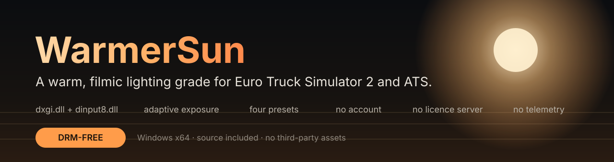
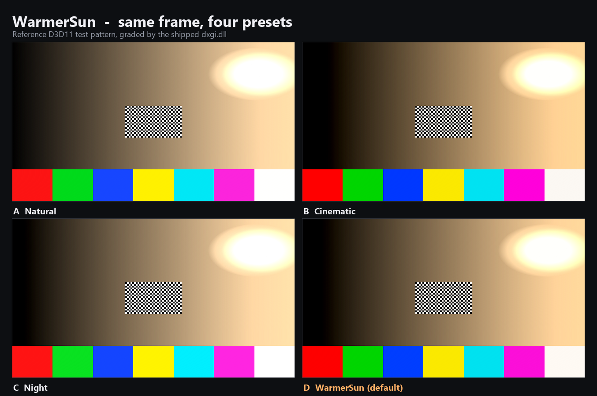
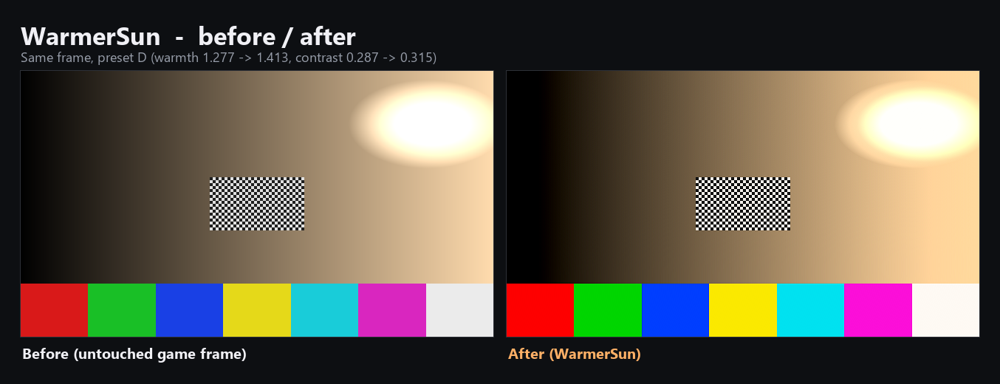

<div align="center">



<p>
  <a href="https://github.com/Deepma1ya/WarmerSun/releases/latest/download/WarmerSun.zip">
    
  </a>
  <a href="https://github.com/Deepma1ya/WarmerSun/releases">
    
  </a>
  
  
</p>

**A warm, filmic lighting grade for Euro Truck Simulator 2 and American Truck Simulator.**
Two DLLs, no account, no licence key, no network access, no telemetry.

</div>

---

## Download

**[WarmerSun.zip](https://github.com/Deepma1ya/WarmerSun/releases/latest/download/WarmerSun.zip)** — contains `dxgi.dll`, `dinput8.dll`, `WarmerSun.ini` and `INSTALL.txt`.

## Install

1. Close the game.
2. Put the three files into the game's binary folder:

   ```
   ...\Steam\steamapps\common\Euro Truck Simulator 2\bin\win_x64\
   ...\Steam\steamapps\common\American Truck Simulator\bin\win_x64\
   ```

3. Start the game.

To uninstall, delete the three files. To disable without deleting, create an empty `WarmerSun.off` next to them.

> Only one module can own `dxgi.dll` in that folder. Remove other DXGI proxies (ReShade's `dxgi.dll`, Special K, a DLSS unlocker) or rename this mod's DLLs to match that setup.

## See it



## Hotkeys

| Key | Action |
|-----|--------|
| `F10` | toggle the grade on/off (A/B comparison) |
| `F11` | cycle preset A → B → C → D |
| `F12` | reload `WarmerSun.ini` while playing |

All three are rebindable in the ini (`KeyToggle`, `KeyPreset`, `KeyReload`).

## Presets

| Preset | Character |
|--------|-----------|
| **A** Natural | subtle correction, close to vanilla |
| **B** Cinematic | deeper contrast, stronger highlight roll-off |
| **C** Night | lifts dark scenes without washing out headlights |
| **D** WarmerSun | **default** — golden highlights, neutral shadows |

## Configure

Everything lives in `WarmerSun.ini`. The file is read at start-up and reloaded with `F12`.

| Group | Keys |
|-------|------|
| Colour | `Temperature`, `Tint`, `PreExposure`, `Exposure`, `PreContrast`, `Contrast`, `Saturation`, `Vibrance` |
| Tonal | `Highlights`, `Shadows`, `Whites`, `Blacks`, `NightExposure`, `SunWarmth` |
| Exposure | `Dynamic`, `AdaptSpeed`, `Key`, `MinEV`, `MaxEV` |
| Detail | `Sharpen`, `Sharpness` (0.20 default), `SharpenEdges` (0.40 default) |

The two sharpening defaults are the reference mod's own recovered values (2/10 and 4/10). Every preset is a full section, so you can edit one without touching the others.

## Troubleshooting

| Symptom | Fix |
|---------|-----|
| Game does not start | Create an empty `WarmerSun.off` next to the DLLs, then delete it to re-enable |
| No visible change | Check `WarmerSun.log` (beside the DLLs, or in `%LOCALAPPDATA%\WarmerSun\`) for `renderer ready` and `swap chain hooked` |
| Game folder is read-only | The log falls back to `%LOCALAPPDATA%\WarmerSun\`; the ini itself can stay read-only |
| Another overlay stopped working | Remove the other `dxgi.dll` proxy from `bin\win_x64` — only one can load |
| Sharpening halos | Lower `Sharpness` and `SharpenEdges` |

## How it works

```
frame ──► copy ──► log-luminance ──► adaptive exposure ──► grade ──► present
                       64×64 → 1×1       1×1 ping-pong    CAS + tonemap
```

- `dxgi.dll` proxies the real DXGI, patches the factory and swap-chain vtables (`Present`, `Present1`, `ResizeBuffers*`) and draws one fullscreen pass before presentation. Device state is saved and restored around it.
- `dinput8.dll` forwards the entire DirectInput 8 API to `System32\dinput8.dll`, then bootstraps the renderer early and honours the `WarmerSun.off` panic switch.
- Shaders are compiled at runtime from embedded HLSL with `d3dcompiler_47.dll`.

The DLLs are statically linked and import only `KERNEL32`/`USER32` plus the Universal CRT.

## Build from source

MinGW-w64 (x86_64) is all you need — no MSVC.

```powershell
powershell -ExecutionPolicy Bypass -File build.ps1
```

Output: `dist\bin\win_x64\{dxgi.dll,dinput8.dll,WarmerSun.ini,INSTALL.txt}`.

## Verification

`tests/` contains a real end-to-end harness: it creates a D3D11 swap chain in a folder with the proxy, renders a known pattern, presents 180 frames and writes both the pre-present and the graded back buffer.

```powershell
powershell -ExecutionPolicy Bypass -File tests\build-tests.ps1
python tests\check_frames.py tests\out\harness_before.dds tests\out\WarmerSun_frame_00000.dds
```



Measured on the reference pattern (preset D): warmth **1.277 → 1.413**, contrast σ **0.287 → 0.315**, highlight clipping **4.48% → 4.08%**.

## Scope and fidelity

WarmerSun is a clean-room reimplementation of the *behaviour* of a commercial ETS2 lighting mod, built from static analysis of its shipped DLLs ([ANALYSIS.md](ANALYSIS.md)). It contains no code or assets from it.

- Architecture, control set, presets, hook position and the two-DLL bootstrap match the reference design.
- The reference replaces the game's HDR `def.tonemap` / `def.adapt` shaders and downloads a shader pack at runtime. Those shaders are not in the shipped DLLs, so WarmerSun currently grades the **presented LDR frame**.
- A shader-level HDR mode (hooking `def.tonemap` / `def.adapt`) is the next phase and needs the game installed to capture the real bytecode.

## Repository layout

```
src/dxgi/       proxy, hooks, renderer, HLSL
src/dinput8/    DirectInput proxy and bootstrap
src/common/     ini parser, logging, presets
assets/         shipped ini and install text
tests/          D3D11 harness and frame comparison
docs/media/     README images
```

## Changelog

See [CHANGELOG.md](CHANGELOG.md).

## Licence

No licence has been chosen yet. Until one is added, all rights are reserved by the repository owner.
